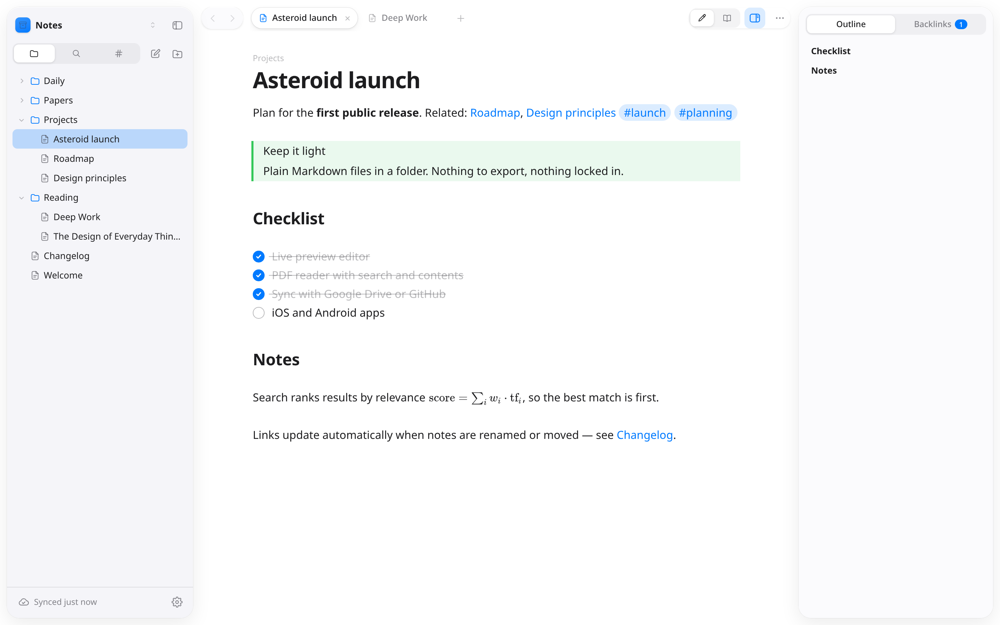

<p align="center">
  
</p>

<h1 align="center">Asteroid</h1>

<p align="center">
  A light, fast Markdown notes app. Plain files in a folder, a calm editor, and sync on your terms.
</p>

<p align="center">
  <a href="../../releases/latest"><b>Download</b></a> ·
  <a href="#install">Install</a> ·
  <a href="#sync">Sync</a> ·
  <a href="#build-from-source">Build from source</a>
</p>

<picture>
  <source media="(prefers-color-scheme: dark)" srcset="docs/screenshot-dark.png">
  
</picture>

Asteroid keeps your notes as ordinary Markdown files in a folder — a **vault** — so they stay
yours: readable by any editor, easy to back up, nothing to export. It opens existing Obsidian
vaults as they are.

## Features

**Writing**
- Live preview: Markdown renders as you type and shows its syntax only on the line you're editing
- `[[Wikilinks]]` with autocomplete, `#tags`, callouts, task lists, tables and frontmatter properties
- Embeds: `![[Note]]`, `![[Note#Heading]]` and `![[Note#^block]]` render inline; images too
- Math with KaTeX: `$inline$` and `$$display$$`
- Links follow along when you rename or move notes and folders

**Finding**
- Full-text search with tag filters, a quick switcher and a command palette
- Outline and backlinks for every note
- A built-in PDF reader with find-in-document and a table of contents

**Sync** (optional, pick one per vault)
- **Google Drive** — files sync as they are; edits made on two devices at once keep both copies
- **GitHub** — full history, automatic merging of edits to different parts of a note, version
  history with restore, recently deleted files, and per-type "don't sync" rules (e.g. PDFs)

**Feel**
- Apple-inspired design with translucent panels, light and dark themes and accent colours
- Small and quick: a Rust core with a native webview, not a bundled browser

## Install

Download the file for your system from the [latest release](../../releases/latest).

| System | File |
|---|---|
| Windows 10/11 | `Asteroid_x.y.z_x64-setup.exe` (or the `.msi`) |
| macOS — Apple Silicon | `Asteroid_x.y.z_aarch64.dmg` |
| macOS — Intel | `Asteroid_x.y.z_x64.dmg` |
| Linux — any distro | `Asteroid_x.y.z_amd64.AppImage` |
| Linux — Debian, Ubuntu, Mint | `Asteroid_x.y.z_amd64.deb` |
| Linux — Fedora, openSUSE | `Asteroid-x.y.z-1.x86_64.rpm` |

The builds aren't code-signed yet, so Windows and macOS ask once before the first launch.

<details>
<summary><b>Windows</b></summary>

Run the installer. If SmartScreen shows "Windows protected your PC", click **More info →
Run anyway**. Asteroid installs for your user only, so no administrator rights are needed.
</details>

<details>
<summary><b>macOS</b></summary>

Open the `.dmg` and drag **Asteroid** into **Applications**. On first launch macOS says it
can't verify the developer: open **System Settings › Privacy & Security**, scroll down and
click **Open Anyway**. If macOS instead reports the app as damaged, clear the download flag
once in Terminal:

```sh
xattr -cr /Applications/Asteroid.app
```
</details>

<details>
<summary><b>Linux</b></summary>

AppImage — make it executable and run it:

```sh
chmod +x Asteroid_*.AppImage
./Asteroid_*.AppImage
```

Debian/Ubuntu: `sudo apt install ./Asteroid_*_amd64.deb` · Fedora: `sudo dnf install ./Asteroid-*.x86_64.rpm`

Arch and others: use the AppImage, or [build from source](#build-from-source).
</details>

## Sync

Sync is optional. Open **Settings › Sync**, connect an account, and choose where the open
vault syncs to. On another device, use **Open from Google Drive** or **Open from GitHub** on
the welcome screen to download it.

Sign-in uses an OAuth app. Release builds may come with one built in; if Settings › Sync
asks for a client ID, create your own (free, a few minutes) and paste it under
**Developer credentials**:

<details>
<summary><b>Google Drive client ID</b></summary>

1. In [Google Cloud Console](https://console.cloud.google.com/), create a project and enable
   the **Google Drive API**.
2. Configure the OAuth consent screen and add your account as a test user.
3. Create an OAuth client ID of type **Desktop app** and paste its ID (and secret) into
   Asteroid. Sign-in then happens in your browser.
</details>

<details>
<summary><b>GitHub client ID</b></summary>

1. On GitHub go to **Settings › Developer settings › OAuth Apps › New OAuth App**. Any
   homepage and callback URL will do.
2. Tick **Enable Device Flow** and save; no secret is needed.
3. Paste the client ID into Asteroid, click **Connect**, and enter the code shown on github.com.

Sign-in asks for the `repo` scope (access to your repositories, including private ones).
GitHub works best for vaults under about 1 GB; Asteroid shows the vault's size, warns
about large files, and lets you leave file types such as PDFs out of sync.
</details>

<details>
<summary><b>How sync handles conflicts</b></summary>

**Google Drive** compares each file with the version from the last sync. Changes on one side
are copied over; changes on both sides keep both, the other one saved as
`Note (conflict YYYY-MM-DD HHMM).md`. Deleted files go to the trash on both sides, and a
sync that would delete more than half the vault asks first.

**GitHub** commits every change, then merges what other devices pushed. Edits to different
lines merge on their own; when two devices change the same lines, the other version is kept
as a conflict copy — no conflict markers are ever written into notes. Every synced version
stays in the history, where you can compare and restore it.
</details>

## Build from source

You need [Rust](https://rustup.rs) 1.90 or newer, [Node.js](https://nodejs.org) 20.19 or
newer, and the [Tauri prerequisites](https://tauri.app/start/prerequisites/) for your system
(on Linux: WebKitGTK 4.1 and its development packages).

```sh
git clone <this repository>
cd asteroid
npm install
npm run tauri dev     # run in development
npm run tauri build   # build installers into target/release/bundle/
```

On Arch-based distributions, run the build as `NO_STRIP=true npm run tauri build` if the
AppImage step fails.

## Development

```sh
cargo test --workspace                  # Rust tests
cargo clippy --workspace --all-targets  # lints
npm run check                           # Svelte and TypeScript checks
```

```
crates/asteroid-core   Vault files, Markdown parsing, search index, link updates, rendering
crates/asteroid-sync   Google Drive sync engine
crates/asteroid-git    Git sync, GitHub sign-in, history and "don't sync" rules
src-tauri              Desktop shell: commands, file watcher, settings
src                    Svelte UI: CodeMirror editor, pdf.js reader
```

The `crates/` have no UI dependency, so the planned iOS and Android apps can share them.

**Releasing:** set the version, tag it and push; GitHub Actions builds the installers for all
three systems and opens a draft release to review and publish.

```sh
node scripts/bump-version.mjs 0.2.0
cargo check && git commit -am "Release 0.2.0"
git tag v0.2.0 && git push origin main v0.2.0
```

## Roadmap

- iOS and Android apps
- Searching inside PDFs from the vault-wide search
- Code highlighting in reading view

## License

[MIT](LICENSE). Asteroid is an independent project and isn't affiliated with Obsidian.
